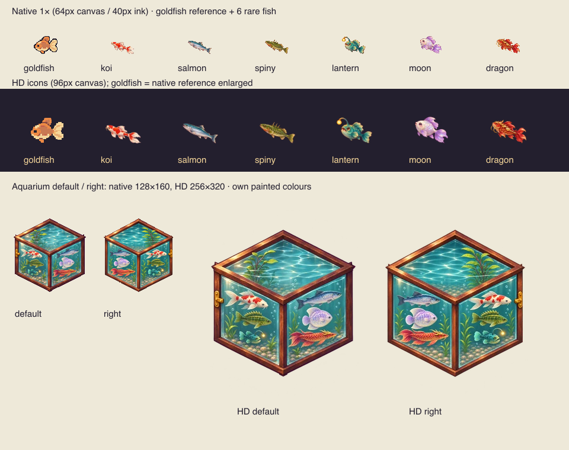

# Rare fish 01 — artwork, 17/11/2026

Hoàn thành **7/7 món**: 6 icon cá hiếm và quà `ev_fish_tank` hai hướng. Không commit, không sửa luật chơi/server, không sync hoặc deploy.

- Sáu ID: `rarefish_koi`, `rarefish_salmon`, `rarefish_spiny`, `rarefish_lantern`, `rarefish_moon`, `rarefish_dragon`. Canvas native 64×64, pivot (32,56), khung mực tối đa 40×30; hướng đầu trái theo `goldfish`. Có HD 128×128 và tra được qua `POND_ART`/`itemArtSpec`.
- Bể kính khung gỗ có đủ sáu loài; `default`/`right` có bố trí cá, cây và chốt khác nhau. Footprint 2×2, native 128×160, pivot (64,144), HD 256×320. Đăng ký `EVENT_ROWS`, `reward:true`, `forSale:false`, `collection:event`, `storeItem:false`.
- Master tạo bằng **ImageGen built-in**. HD Lanczos giữ màu vẽ, không ép palette; native dựng từ HD thật bằng Lanczos, alpha ngưỡng 128, theo quy trình winter. Hai hướng bể là tranh tĩnh; atlas có bốn frame giống nhau cho mỗi hướng, không khai báo chuyển động giả.

## File tạo/sửa

- `garden-v05/masters-items/rare-fish/`: 8 master PNG, guide SVG/PNG, `provenance.json` (prompt, nguồn, SHA-256), `export-receipt.json` (native/HD và hash).
- `garden-v05/native-items/rarefish_*.png`: 6 icon native.
- `garden-v05/decor-assets/native/ev_fish_tank{,_right,_atlas}.png`: hai hướng và atlas.
- `garden-v05/decor-assets/hd/`: 9 WebP HD theo hash, tra đường dẫn cụ thể trong receipt và `HD_ART`.
- `garden-v05/runtime-webp/`: 9 WebP native tương ứng; cập nhật `runtime-webp-manifest.json`, `runtime-image-url.mjs`.
- `garden-v05/pond-art.mjs`, `hd-art.mjs`, `decor-assets-manifest.json`, `special-products.mjs`: chỉ thêm record của brief.
- `garden-v05/build-rare-fish-art.mjs`, `rare-fish-art.test.mjs`, `festival-lazy-art.test.mjs`: xuất lại và kiểm chứng artwork/renderer.
- `docs/codex-briefs/rare-fish-01-preview/`: ảnh và số đo.

Không sửa 270 record decor cũ, 1.930 mapping HD cũ hoặc record POND_ART cũ. Đối chiếu HEAD xác nhận toàn bộ record/hash ảnh runtime cũ giữ nguyên. Các sửa đổi đồng thời ở `game-panels.css`, `garden-pond-ui*`, `mobile-game.mjs`, `ui-utils.mjs` không thuộc phần thực hiện brief này và được giữ nguyên.

## Ảnh xem trước



Đã xem ảnh ở native 1× và HD; sáu loài có hình và màu riêng. Bể nhìn thấy đủ sáu cá ở cả hai hướng. [Số đo cạnh và grid-fit](rare-fish-01-preview/validation.json).

## Kiểm tra

**45/45 test đạt:**

```sh
node --test garden-v05/rare-fish-art.test.mjs garden-v05/art-refresh.test.mjs garden-v05/flow-art.test.mjs garden-v05/hd-procedural.test.mjs garden-v05/render-resolution.test.mjs garden-v05/festival-lazy-art.test.mjs garden-v05/isometric-art-validation.test.mjs
node garden-v05/build-runtime-webp.mjs --check
git diff --check
```

- Master/native hash, HD density/kích thước, alpha nhị phân, native tái tạo đúng từ HD, lookup icon, atlas RGBA, quà không bán: đạt.
- Renderer thật trong recording-canvas test tải lười bể khi đặt ngoài mùa lễ hội và chọn đúng rect của cả hai hướng: đạt.
- `audit-grid-fit.mjs`: bể đạt cả 2/2 hướng, không có lỗi. Chuyển riêng đầu ra audit sang `/tmp` để không ghi đè tài liệu audit chung; trích kết quả trong validation.json.
- Đo trực tiếp tám cạnh trên raster native: default sai số tối đa 0,5 px, right tối đa 1 px; ngưỡng repo ≤1 px. Góc phải đầu tiên vượt 1 px đã được vẽ lại trước khi nhận.
- WebP pack: **2.122** chuyển đổi lossless + **1.869** WebP sẵn có; builder đối chiếu RGBA, `--check` xác nhận inventory/hash.

**Giới hạn bằng chứng:** chưa kiểm trình duyệt, điện thoại, đặt/cất/save thật hoặc mọi thời tiết. Sandbox trả `Operation not permitted` khi bind cổng HTTP local và chặn khởi chạy Chrome. Ảnh preview là bản ghép artwork; recording-canvas là kiểm renderer tự động, không phải ảnh chụp game trong trình duyệt. Luật nhận cá/trao quà thuộc phần Claude Code theo brief.
